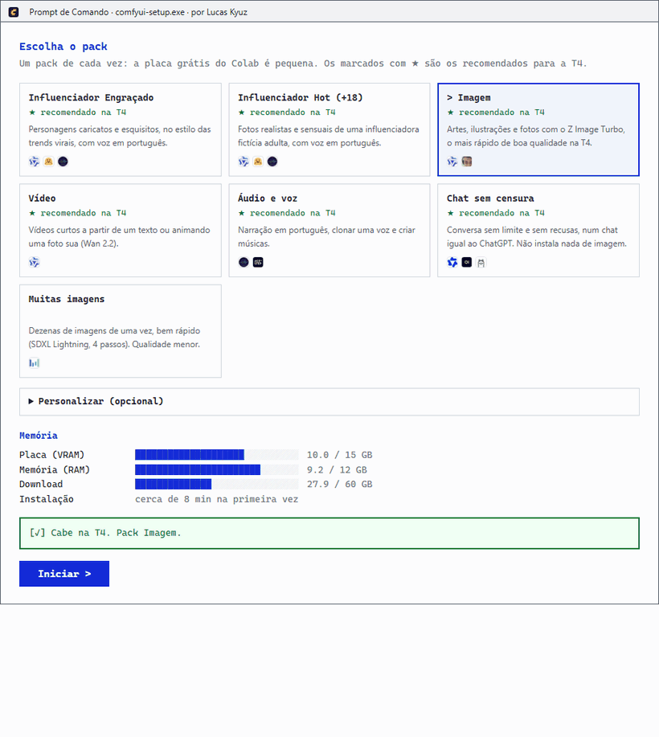
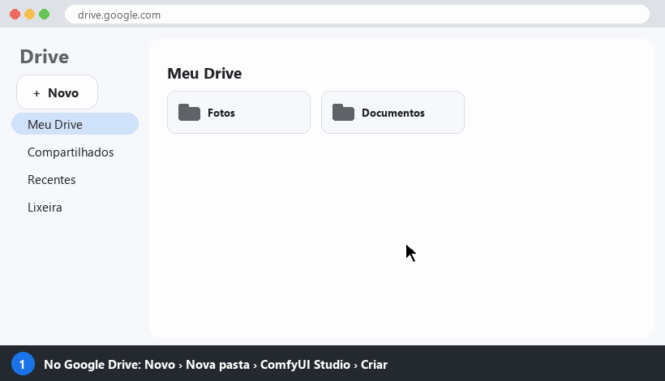
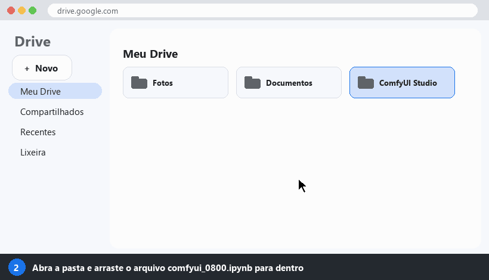
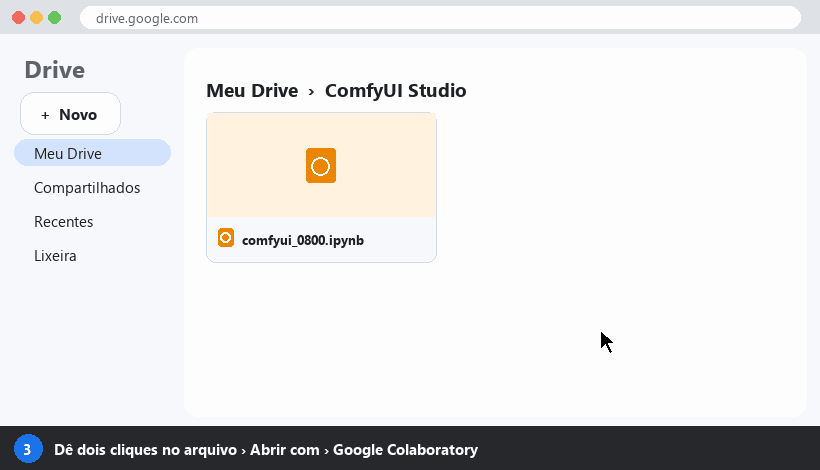
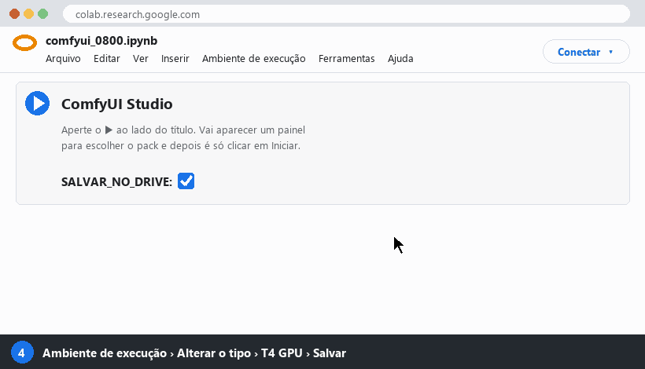
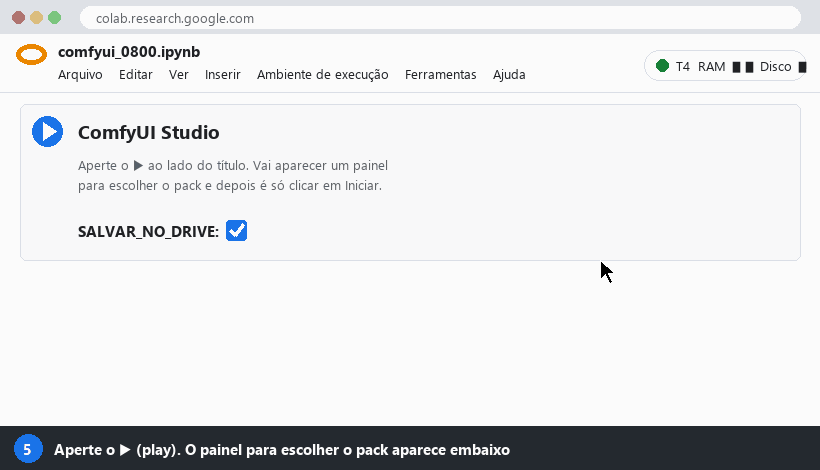
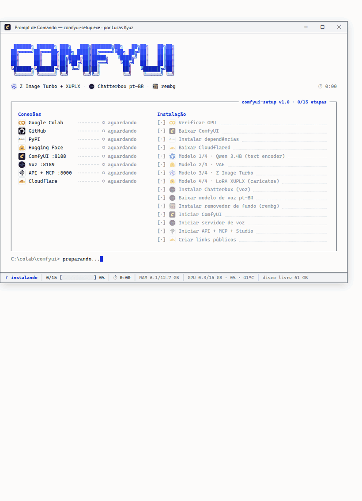
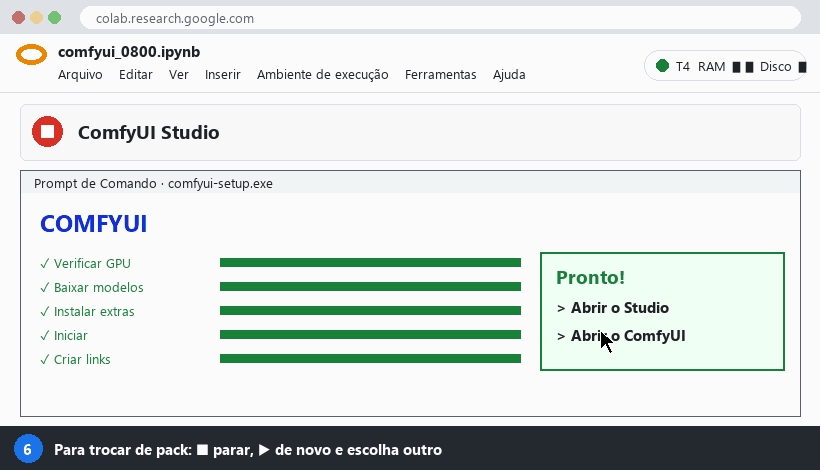

# ComfyUI Studio 0800

**Crie imagens, vídeos, vozes e converse com uma IA sem censura, de graça, direto do navegador.**

Não precisa instalar nada no computador, não precisa de placa de vídeo e não precisa saber programar.
Basta uma conta Google.

Criado por **Lucas Kyuz** e aberto para a comunidade.

&nbsp;
&nbsp;
&nbsp;
&nbsp;
&nbsp;
&nbsp;
&nbsp;
&nbsp;
&nbsp;

---

## O que dá para fazer

Você escolhe um **pack**, que é um kit pronto, e o Studio instala só o que aquele pack usa.
Os marcados com ★ foram montados para a placa grátis do Google Colab (a **T4**): priorizamos o que é rápido, leve e não trava.

| Pack | Para quê | O que vem dentro |
|---|---|---|
| ★ **Influenciador Engraçado** | Personagens caricatos e esquisitos, no estilo das trends virais, com voz em português | Z Image Turbo, LoRA XUPLX, Chatterbox pt-BR, rembg |
| ★ **Influenciador Hot (+18)** | Fotos realistas e sensuais de uma influenciadora fictícia adulta, com voz em português | Z Image Turbo, LoRA UltraReal, Chatterbox pt-BR, rembg |
| ★ **Imagem** | Artes, ilustrações e fotos | Z Image Turbo, rembg |
| ★ **Vídeo** | Vídeos curtos a partir de um texto ou animando uma foto sua | Wan 2.2 5B com a LoRA FastWan (4 passos) |
| ★ **Áudio e voz** | Narração em português, clonar uma voz, criar músicas | Chatterbox pt-BR, ACE-Step |
| ★ **Chat sem censura** | Conversar sem limite e sem recusas, num chat parecido com o ChatGPT | Qwen3.5 9B sem censura, Open WebUI, Whisper (microfone) |
| **Muitas imagens** | Dezenas de imagens de uma vez, bem rápido (qualidade menor) | SDXL Lightning |

**Um pack de cada vez.** A placa grátis tem 15 GB de memória de vídeo e a máquina tem 12 GB de RAM.
O painel mostra quanto cada coisa ocupa e não deixa iniciar o que não cabe:

---

## Passo a passo

Só a primeira vez dá um pouco de trabalho (uns 5 minutos). Depois é abrir e apertar o play.

### 1. Crie uma pasta no seu Google Drive

Abra o [Google Drive](https://drive.google.com), clique em **Novo > Nova pasta** e dê o nome **ComfyUI Studio**.

### 2. Coloque o arquivo do Studio dentro da pasta

Baixe o arquivo **[comfyui_0800.ipynb](comfyui_0800.ipynb)**: clique nele aqui no GitHub e depois no botão de download, no canto direito.
Depois abra a pasta **ComfyUI Studio** no Drive e arraste o arquivo para dentro.

### 3. Abra o arquivo no Google Colab

Dê **dois cliques** no arquivo. Na primeira vez o Drive pergunta com qual programa abrir: escolha **Google Colaboratory**.

Se o Google Colaboratory não aparecer na lista, clique em **Conectar mais apps**, procure por **Colaboratory** e instale. É do próprio Google e é grátis.

### 4. Ligue a placa de vídeo grátis (T4)

No menu de cima: **Ambiente de execução > Alterar o tipo de ambiente de execução > T4 GPU > Salvar**.

Isso só precisa ser feito uma vez. O Colab lembra a escolha nesse arquivo.

### 5. Aperte o play e escolha o pack

Aperte o botão **▶** ao lado do título. Aparece o painel com os packs: clique no que você quer e depois em **Iniciar**.

O Colab mostra alguns avisos, e é normal:

- **"Este notebook não é do Google"**: clique em **Executar assim mesmo**. O código inteiro está aqui no GitHub, aberto para qualquer um ler.
- **"Permitir acesso ao Google Drive?"**: clique em **Permitir**. É assim que o que você cria fica salvo no seu Drive.

Agora é só esperar. O painel mostra cada etapa com uma barra de progresso.
Na primeira vez leva de **5 a 15 minutos**, dependendo do pack, porque os modelos são baixados.

Quando aparecer a **caixa verde**, clique no link:

- **Studio**: onde você cria imagens, vídeos e áudios.
- **Chat**: a conversa com a IA (no pack Chat sem censura).
- **ComfyUI**: o editor avançado, para quem já conhece.

**Não feche a aba do Colab** enquanto estiver usando. Se fechar, o Studio desliga.

---

## Como trocar de pack

1. Aperte o **■** (parar), no lugar do play.
2. Aperte o **▶** de novo.
3. Escolha outro pack no painel e clique em **Iniciar**.

Ao parar, tudo o que estava na memória é desligado, então o pack novo começa com a placa livre.
Os modelos que já foram baixados continuam no disco enquanto a sessão estiver ligada, então voltar para um pack que você já usou é bem mais rápido.
Se o disco começar a encher, o Studio apaga sozinho os modelos de packs antigos que o pack novo não usa.

**Ficou lento ou deu um erro estranho?** Use **Ambiente de execução > Desconectar e excluir ambiente de execução** e aperte o ▶ de novo.
É o "desligar e ligar" do Colab: começa tudo do zero e baixa os modelos de novo.

---

## Onde ficam os meus arquivos

Com a opção **SALVAR_NO_DRIVE** marcada (ela já vem marcada), tudo o que você cria vai para o seu Google Drive:

| Pasta no seu Drive | O que tem lá |
|---|---|
| `ComfyUI_output` | Imagens, vídeos, músicas e efeitos que você gerou |
| `ComfyUI_vozes` | As vozes que você gravou ou enviou para clonar |

Assim nada se perde quando o Colab desliga.
Os **modelos**, que são arquivos de vários GB, **não** vão para o Drive, para não lotar o seu espaço.
Eles ficam só na máquina do Colab e são baixados de novo quando ela é reiniciada.

---

## Chat sem censura e sem limite

O pack **Chat sem censura** liga uma IA que roda **dentro do seu Colab**, e não no servidor de outra empresa.

- **Sem limite de mensagens.** Não tem plano pago nem "você atingiu o limite de hoje".
- **Sem recusas.** São versões do Qwen3.5 com as recusas removidas (os modelos "abliterated").
- **Privado.** As conversas ficam só na sua sessão. Quando o Colab desliga, elas somem, então salve o que for importante.
- **Chat completo (Open WebUI):** histórico de conversas, editar mensagens, código formatado, enviar arquivos e imagens.

---

## Por que um pack de cada vez

O Colab grátis empresta uma placa **Tesla T4**, com **15 GB de memória de vídeo (VRAM)**, numa máquina com **12 GB de RAM**.
Cada modelo ocupa um pedaço dessa memória. Os números abaixo são aproximados e de propósito um pouco pessimistas:

| O que | Memória de vídeo |
|---|---|
| Z Image Turbo (imagem) | ~10 GB |
| Wan 2.2 5B (vídeo) | ~12 GB |
| ACE-Step (música) | ~8 GB |
| Qwen3.5 9B (chat) | ~8 GB |
| Chatterbox (voz) | ~3 GB |

Quando a soma passa de 15 GB, ou aparece erro de memória, ou tudo fica **muito** lento, porque o Colab passa a tirar e colocar modelo na placa a cada pedido.
Por isso o painel trava as combinações que não cabem.

Algumas escolhas que fizemos para a T4:

- **Z Image Turbo** em vez de FLUX ou Qwen-Image: é o que tem medição de 18 a 40 segundos por imagem na T4. O peso é carregado em fp8 para não estourar a RAM.
- **Wan 2.2 5B com FastWan** em vez do Wan 2.1 1.3B: o mesmo modelo faz texto para vídeo e foto para vídeo, em 4 passos em vez de 20.
- **MiniMax H3, Krea 2, LTX-2 e InfiniteTalk ficaram de fora**: precisam de 24 GB ou mais de placa, ou de mais RAM do que o Colab grátis tem.

---

## Problemas comuns

<b>Apareceu "Sem GPU" ou "No GPU"</b>

Faltou o passo 4. Vá em **Ambiente de execução > Alterar o tipo de ambiente de execução > T4 GPU > Salvar** e aperte o ▶ de novo.

<b>"Não é possível se conectar a um back-end de GPU" ou acabou a cota</b>

O Colab grátis tem um limite de uso de GPU por dia, de algumas horas, e ele varia. Quando acaba, espere algumas horas (normalmente até o dia seguinte) e tente de novo.
Dica: **desligue a sessão quando terminar** (Ambiente de execução > Desconectar e excluir ambiente de execução), para não gastar a cota à toa.

<b>O Colab desconectou sozinho</b>

O Colab grátis desliga depois de um tempo sem você mexer na aba, ou depois de algumas horas de uso. É só apertar o ▶ de novo.
O que você criou está salvo no Drive, na pasta `ComfyUI_output`.

<b>Ficou muito lento ou deu "out of memory"</b>

Use **Ambiente de execução > Desconectar e excluir ambiente de execução** e comece de novo, com um pack só.
Evite vídeos longos ou imagens muito grandes na T4.

<b>O link não abre</b>

Os links mudam toda vez que você aperta o ▶. Use sempre o link da caixa verde **mais recente**. Se nada abrir, aperte ■ e ▶ de novo.

---

## Uso responsável

Este projeto liga modelos **sem filtro**. Você é responsável pelo que cria e publica.

- **Não** crie imagens, vídeos ou vozes de pessoas reais sem a autorização delas. No Brasil isso pode ser crime e dar processo.
- **Não** use a clonagem de voz para enganar ninguém ou aplicar golpes.
- Se for publicar um influenciador virtual, **avise que o conteúdo foi feito com IA**. Muitas redes sociais exigem isso.
- Conteúdo envolvendo menores de idade é proibido, sempre. O Studio recusa pedidos que juntam menores com qualquer coisa sexual, em todos os packs.
- O pack **Hot (+18)** é só para personagens **fictícios e adultos**: ele recusa qualquer pedido que mencione menores de idade. Não use para criar fotos de pessoas reais.

---

## Como contribuir

Este projeto é da galera. Se você testou alguma coisa que funciona bem no Colab grátis, manda pra gente:

- **LoRAs** que deram bons resultados com o Z Image Turbo, o Wan 2.2 ou o SDXL Lightning.
- **Modelos** que rodam bem na T4 (imagem, vídeo, voz, música ou chat).
- **Presets e packs** novos, com as configurações que você usa.
- **Correções** de erros, melhorias no Studio e na documentação, traduções.

Como mandar:

1. Faça um **fork** deste repositório (botão **Fork**, no canto de cima).
2. Faça a sua mudança. O código da célula fica em [`dev/studio_cell.py`](dev/studio_cell.py), e os modelos e packs estão logo no começo dele (`ITENS`, `CHATS` e `PACKS`).
3. Rode `python montar_notebook.py` de dentro da pasta `dev` para atualizar o notebook.
4. Abra um **Pull Request** contando o que mudou e **como você testou na T4**: o tempo por imagem ou vídeo, a memória usada e se deu algum erro.

Se não sabe programar, tudo bem: abra uma **[Issue](../../issues)** com o link do modelo ou da LoRA e o resultado que você conseguiu, que a gente testa e coloca.

A regra para entrar num pack com ★ é simples: **tem que rodar na T4 grátis sem travar**. Na dúvida, entra como opção em "Personalizar".

---

## Créditos

O Studio só junta e configura ferramentas abertas criadas por outras pessoas. Cada uma tem a sua licença, e algumas não permitem uso comercial: confira antes de vender o que você criou.

| | Projeto | Usado para | Licença |
|---|---|---|---|
|  | [ComfyUI](https://github.com/comfyanonymous/ComfyUI) | Motor de imagem, vídeo e áudio | GPL-3.0 |
|  | [Z Image Turbo](https://huggingface.co/Tongyi-MAI/Z-Image-Turbo) | Imagens | Apache 2.0 |
|  | [Lenovo UltraReal](https://huggingface.co/Danrisi/Lenovo_UltraReal_Z_Image), por Danrisi | LoRA de realismo | veja a página do autor |
|  | [XUPLX Ugly People](https://huggingface.co/danrhern/XUPLX), por danrhern | LoRA de personagens caricatos | Apache 2.0 |
|  | [Wan 2.2](https://github.com/Wan-Video/Wan2.2) | Vídeo | Apache 2.0 |
|  | [FastWan](https://huggingface.co/Kijai/WanVideo_comfy), versão para ComfyUI por Kijai | Vídeo em 4 passos | Apache 2.0 |
|  | [SDXL Lightning](https://huggingface.co/ByteDance/SDXL-Lightning) | Muitas imagens | OpenRAIL++ |
|  | [Chatterbox](https://github.com/resemble-ai/chatterbox) | Voz em português e clonagem | MIT |
|  | [ACE-Step](https://github.com/ace-step/ACE-Step) | Música | Apache 2.0 |
|  | [Stable Audio Open](https://huggingface.co/stabilityai/stable-audio-open-1.0) | Efeitos sonoros | Stability AI Community |
|  | [Qwen3.5](https://github.com/QwenLM) (versões abliterated por [huihui_ai](https://ollama.com/huihui_ai)) | Chat | Apache 2.0 |
|  | [Ollama](https://github.com/ollama/ollama) | Roda o chat | MIT |
|  | [Open WebUI](https://github.com/open-webui/open-webui) | Tela do chat | Open WebUI License |
|  | [faster-whisper](https://github.com/SYSTRAN/faster-whisper) | Microfone (fala para texto) | MIT |
|  | [rembg](https://github.com/danielgatis/rembg) | Remover fundo | MIT |
|  | [Cloudflare Tunnel](https://github.com/cloudflare/cloudflared) | Links públicos | Apache 2.0 |
|  | [Google Colab](https://colab.research.google.com) | A máquina grátis com a T4 | |

<b>Para programadores</b>

- O notebook tem uma célula só. O código dela fica em [`dev/studio_cell.py`](dev/studio_cell.py) e é colocado no notebook por [`dev/montar_notebook.py`](dev/montar_notebook.py).
- Os GIFs do passo a passo são desenhados por [`dev/gerar_gifs.py`](dev/gerar_gifs.py). Os GIFs dos painéis são capturas reais do código, gravadas por [`dev/gravar_paineis.py`](dev/gravar_paineis.py) (precisa do Playwright).
- Com o Studio no ar, a página **API + MCP (docs)** mostra as rotas HTTP, compatíveis com a API da OpenAI, e como ligar o MCP no Claude, no Cursor e em outros clientes.

